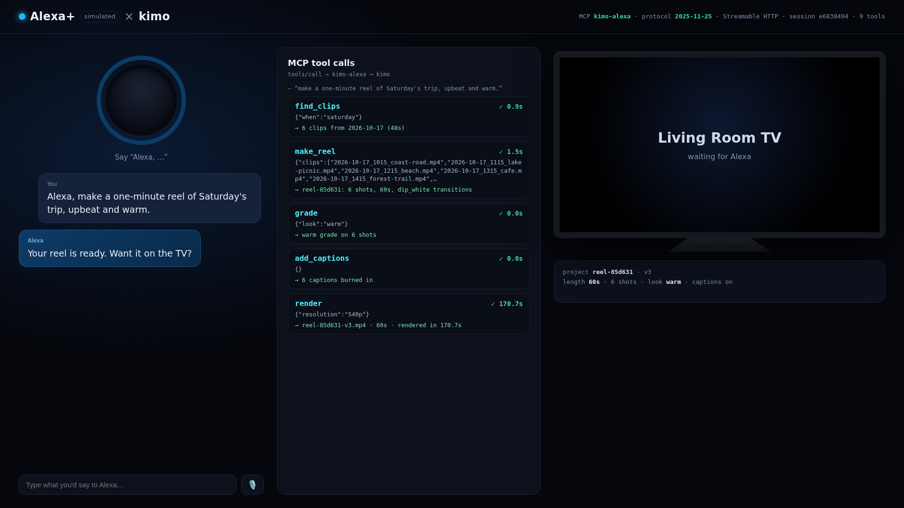
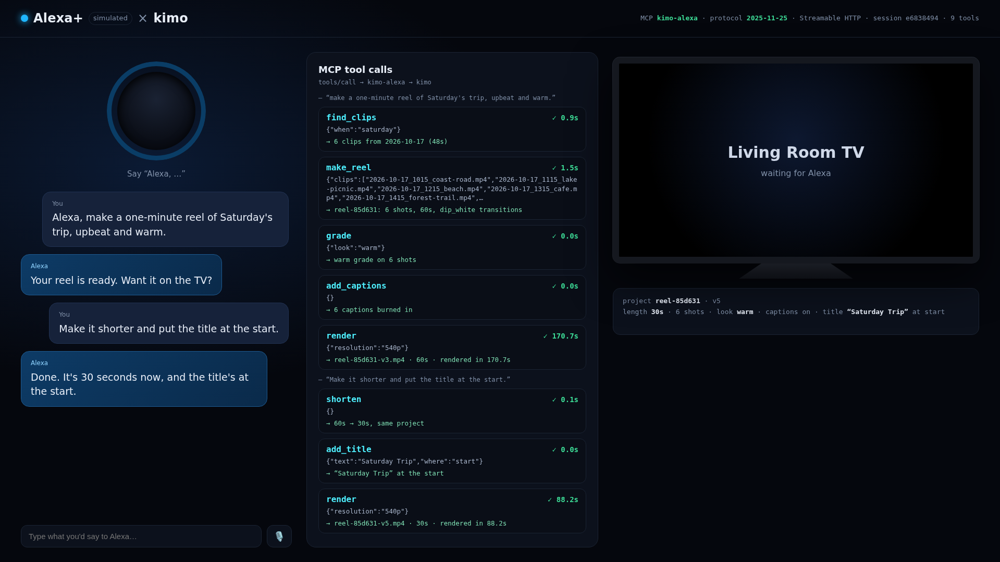
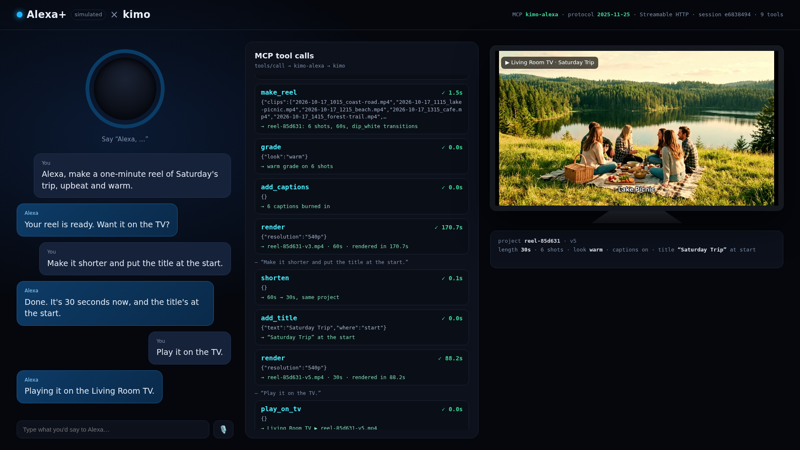

# kimo-alexa

**Say the cut, and Alexa makes it.**

kimo-alexa is a self-hosted **MCP server** (spec **2025-11-25**, **Streamable HTTP**) that puts [kimo](https://github.com/naman-sharma12345/kimo), a free MIT-licensed video engine written in Rust, behind Alexa+. It gives a voice assistant a handful of voice-sized editing tools (`find_clips`, `make_reel`, `grade`, `add_captions`, `add_title`, `shorten`, `render`, `play_on_tv`) and carries out every one of them with real kimo edits on your own machine.

Because Alexa+ MCP add-ons are only open to select partners right now, the repo also ships a **simulated Alexa+** web app that drives the server as a real MCP client over HTTP, so the whole flow can be run and watched end to end.

Built for the Amazon **Build, Ship, Shape** hackathon (Alexa+ track and Open Source mini challenge), during the hackathon window in October 2026.



## What it does

> "Alexa, make a one-minute reel of Saturday's trip, upbeat and warm."

`find_clips` → `make_reel` → `grade(warm)` → `add_captions` → `render` → *"Your reel is ready. Want it on the TV?"*

> "Make it shorter and put the title at the start."

`shorten` → `add_title` → `render`, on the **same project** (it edits, it doesn't start over).

> "Play it on the TV."

`play_on_tv` → the reel plays on the (simulated) living-room TV.

| Same-project follow-up edit | Playing on the TV |
| --- | --- |
|  |  |

## Architecture

```
 ┌──────────────────────────┐   Streamable HTTP (MCP 2025-11-25)   ┌───────────────────────────┐   stdio MCP    ┌──────────────┐
 │ Alexa+  (or the simulated│   POST /mcp  JSON-RPC 2.0            │ kimo-alexa  (this repo)    │  (2024-11-05)  │  kimo-mcp    │
 │ Alexa+ web app in web/)  │ ───────────────────────────────────▶ │ Node.js, official MCP SDK │ ─────────────▶ │  Rust engine │
 │  utterance → tool calls  │ ◀─────────────────────────────────── │ 8 voice-sized tools        │ ◀───────────── │  + ffmpeg    │
 └──────────────────────────┘   JSON or SSE (progress events)      │ one kimo child per project │                └──────────────┘
                                Mcp-Session-Id                     │ projects saved as .kimo    │
                                MCP-Protocol-Version               └───────────────────────────┘
```

* **Transport:** one `/mcp` endpoint. `POST` carries JSON-RPC; responses come back as an SSE stream (used for `notifications/progress` while kimo renders) or JSON. The server issues an `Mcp-Session-Id` on `initialize`; clients send it plus `MCP-Protocol-Version: 2025-11-25` on every later request. `GET` opens the server-to-client stream, `DELETE` ends a session. Browser `Origin`s other than localhost are rejected (DNS-rebinding guard).
* **SDK:** the official `@modelcontextprotocol/sdk` (TypeScript, v1.32) `McpServer` + `StreamableHTTPServerTransport`, which negotiates `2025-11-25`.
* **kimo side:** each reel gets its own long-lived `kimo-mcp` child process (spoken to with the SDK's stdio client). The timeline stays in memory and is saved to `data/projects/<id>.kimo` after every edit, so follow-ups ("make it shorter") change the same project.
* **The simulated Alexa+** (`web/`) is a static page with a hand-written browser MCP client (`web/mcp-client.js`) and a **deterministic planner** (`web/app.js`) that maps an utterance to a sequence of tool calls. It is a stand-in for the Alexa+ agent, not a language model, and it says so on screen ("simulated"). The "TV" is a pane in the same page that polls `/tv` and plays what `play_on_tv` set.

## Tools

| Tool | What it does | kimo calls underneath |
| --- | --- | --- |
| `find_clips(when, folder?)` | clips shot on a day (`saturday`, `yesterday`, `2026-10-17`), in shooting order | ffprobe of the camera roll (read-only) |
| `make_reel(clips, length_s=60, mood)` | new project: imports, cuts shots to fit the length, mood transitions | `project.project_set`, `timeline.add_track`, `project.import_media`, `timeline.add_clip`, `timeline.trim_clip`, `timeline.move_clip`, `effects.add_transition`, `project.save_project` |
| `grade(look)` | warm, cool, vivid, vintage, mono, natural on every shot | `color_grade.set_color_wheels` |
| `add_captions()` | a caption per shot (where it was filmed); rebuilt when the cut changes | `text.add_captions` (SRT), `timeline.delete_clip` |
| `add_title(text, where)` | title over the start or the end | `text.add_text` |
| `shorten(target_s?)` | trims every shot evenly (default: half the length) on the same project | `timeline.trim_clip`, `timeline.move_clip`, captions rebuilt |
| `render(resolution)` | H.264 MP4, streamed progress notifications while it works | `output.export` |
| `play_on_tv(device?)` | plays the latest render on the living-room screen (simulated) | — |
| `kimo_raw(tool, arguments)` | advanced passthrough to any of kimo's group tools on a reel's project | any |

## Quick start

Requirements: Node 20+, ffmpeg/ffprobe, and a `kimo-mcp` binary.

```bash
git clone https://github.com/naman-sharma12345/kimo-alexa && cd kimo-alexa
npm install

# kimo-mcp: download a release (linux x86_64 shown) or build from source (cargo build --release -p kimo-mcp)
curl -L https://github.com/naman-sharma12345/kimo/releases/download/v5.0.0/kimo-v5.0.0-linux-x86_64-glibc.tar.gz | tar xz
mkdir -p bin && cp kimo-v5.0.0-linux-x86_64-glibc/bin/kimo-mcp bin/      # or set KIMO_BIN=/path/to/kimo-mcp

sh footage/make.sh        # builds the demo "Saturday trip" clips from the stills in footage/src
npm start                 # MCP at http://127.0.0.1:8787/mcp , simulated Alexa+ at http://127.0.0.1:8787/
```

Open `http://127.0.0.1:8787/` and type *"Alexa, make a one-minute reel of Saturday's trip, upbeat and warm."*

Talk to the server with plain curl (`tools/curl_demo.sh` does this):

```bash
curl -si http://127.0.0.1:8787/mcp -H 'Content-Type: application/json' -H 'Accept: application/json, text/event-stream' \
  -d '{"jsonrpc":"2.0","id":1,"method":"initialize","params":{"protocolVersion":"2025-11-25","capabilities":{},"clientInfo":{"name":"curl","version":"1"}}}'
# → Mcp-Session-Id: …   data: {"result":{"protocolVersion":"2025-11-25", …}}
```

Any MCP client that speaks Streamable HTTP can connect too (MCP Inspector, or an Alexa+ add-on pointed at the URL through a tunnel such as cloudflared).

Environment: `PORT` (8787), `HOST` (127.0.0.1), `KIMO_BIN`, `FOOTAGE_DIR`, `DATA_DIR`.

## Repo layout

```
src/server.mjs      MCP server: Streamable HTTP, sessions, the 8 tools, static web app, /tv state
src/kimo.mjs        stdio client for kimo-mcp (one child per project)
web/                simulated Alexa+ (index.html, style.css, app.js planner, mcp-client.js)
footage/            demo stills (AI-generated, no copyrighted material) + make.sh (ffmpeg Ken Burns clips)
tools/record.py     records the demo scenes for real (Xvfb + Chromium + ffmpeg)
tools/curl_demo.sh  initialize + tools/list over Streamable HTTP with curl
docs/               screenshots
```

## Honest notes

* The Alexa+ side is **simulated**: Alexa+ MCP add-ons are limited to select partners, so this was not deployed to a real Alexa+ device. The server itself is a standard Streamable HTTP MCP server and is what an Alexa+ add-on would point at.
* No auth yet. Alexa+ requires OAuth 2.1 + PKCE (or client credentials) for add-ons; run it on localhost or behind your own auth.
* Rendering takes real time (about 1.5 to 3x the reel length on a 2-core machine at 540p), far over Alexa+'s 500 ms round-trip guideline. A real add-on would return immediately and finish the render as a background task.
* Demo footage is Ken Burns motion over AI-generated stills of a "Saturday trip"; there is no music.
* Fonts in `fonts/` (Fraunces, Inter) are under the SIL Open Font License.

## License

MIT © 2026 Naman Sharma. kimo itself is a separate MIT project: <https://github.com/naman-sharma12345/kimo>.
